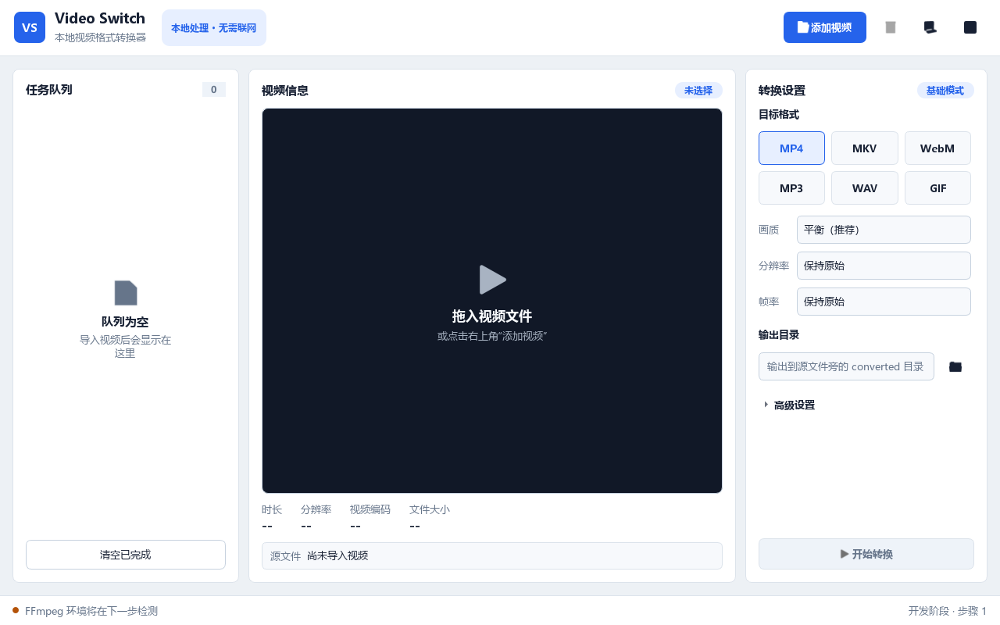

# Video Switch 视频转换器

Video Switch 是一款基于 PySide6 的桌面视频格式转换器。应用通过本地
FFmpeg 命令行完成视频信息读取、缩略图生成和格式转换，不依赖远程 API，
也不会上传用户视频。

> 当前状态：步骤 1 已完成，桌面客户端界面骨架可以运行，视频业务功能尚未接入。



## 项目目标

- 导入常见视频并显示文件信息。
- 通过 ffprobe 读取时长、分辨率、帧率和音视频编码。
- 通过 ffmpeg 生成并展示视频缩略图。
- 提供 MP4、MKV、WebM、MP3、WAV 和 GIF 等转换预设。
- 展示转换进度、速度、剩余时间、日志和错误信息。
- 支持任务取消、批量队列、输出目录和文件命名设置。
- 打包为不依赖 Python 环境的 Windows 桌面应用。

## 技术栈

- Python 3.12+
- PySide6-Essentials / Qt Widgets
- QProcess
- ffmpeg / ffprobe 命令行
- pytest / pytest-qt
- Ruff
- PyInstaller
- uv

## 运行要求

- Windows 10/11
- uv

安装依赖并启动：

```powershell
uv sync
uv run video-switch
```

也可以使用模块入口：

```powershell
uv run python -m video_switch
```

## 开发检查

```powershell
uv run pytest
uv run ruff check .
uv run ruff format --check .
```

## 项目结构

```text
video-switch/
├── docs/                         项目过程与决策文档
├── src/video_switch/             应用源码
│   └── ui/                       主窗口、主题和界面组件
├── tests/                        自动化测试
├── pyproject.toml                项目与依赖配置
├── uv.lock                       可复现依赖锁
└── README.md
```

## 开发步骤

- [x] 步骤 0：项目结构、uv 配置、桌面运行环境和文档骨架
- [x] 步骤 1：桌面客户端主界面
- [ ] 步骤 2：FFmpeg 环境检测
- [ ] 步骤 3：视频导入流程
- [ ] 步骤 4：视频信息读取
- [ ] 步骤 5：缩略图生成
- [ ] 步骤 6：转换参数与预设界面
- [ ] 步骤 7：单文件转换引擎
- [ ] 步骤 8：批量任务队列
- [ ] 步骤 9：异常处理与恢复
- [ ] 步骤 10：界面优化
- [ ] 步骤 11：自动测试与性能优化
- [ ] 步骤 12：打包与 GitHub 发布
- [ ] 步骤 13：面试演示材料

## 相关文档

- [会话总结](docs/会话总结.md)
- [开发决策记录](docs/开发决策记录.md)
- [FFmpeg 入门说明](docs/FFmpeg说明.md)

## API 说明

运行时不调用 OpenAI、云端转换、账号或其他远程 API。AI 仅用于辅助开发，
所有媒体处理均在本机通过 ffmpeg/ffprobe 命令行完成。
