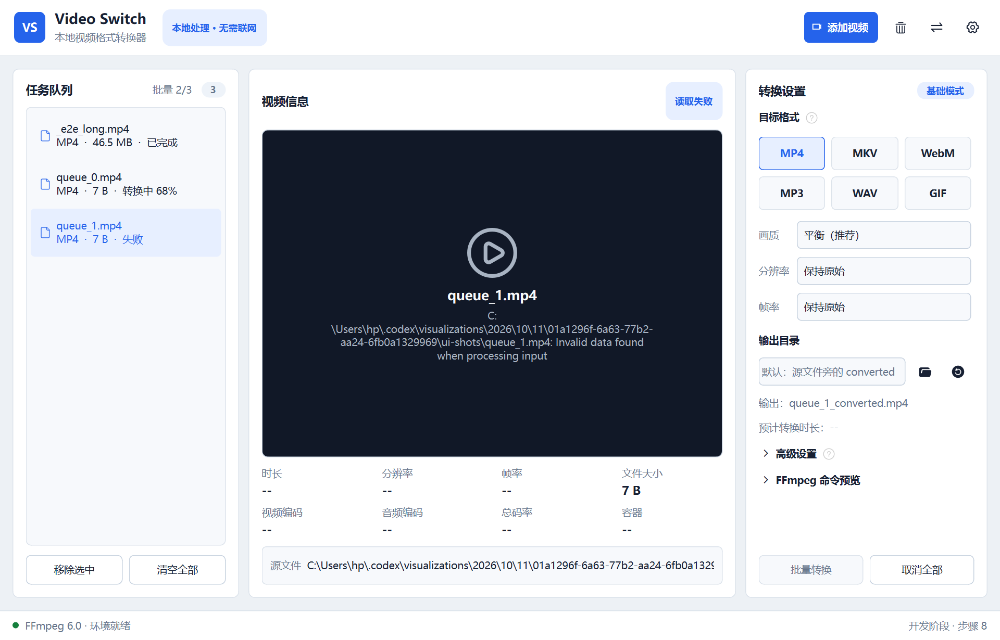
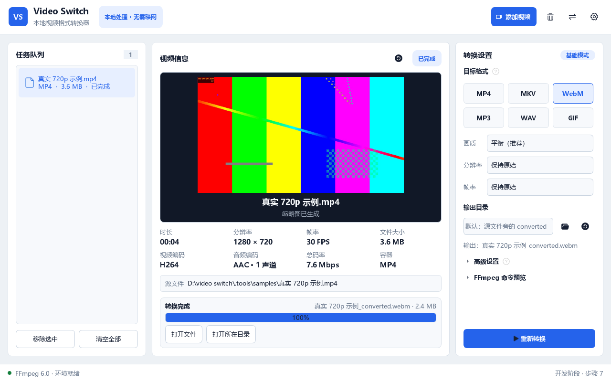
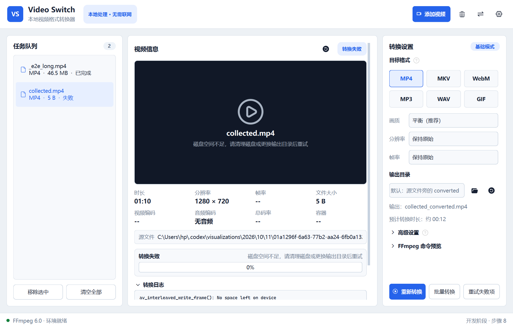
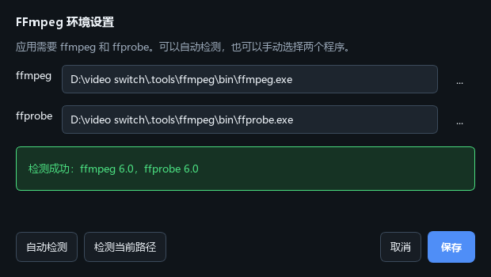

# Video Switch 视频转换器

Video Switch 是一款基于 PySide6 的桌面视频格式转换器。应用通过本地
FFmpeg 命令行完成视频信息读取、缩略图生成和格式转换，不依赖远程 API，
也不会上传用户视频。

> 当前状态：步骤 10 已完成，异常处理、恢复能力与界面打磨均已就位。










## 项目目标

- 导入常见视频并显示文件信息。
- 支持文件选择和拖拽批量导入。
- 检查文件格式与重复任务，并显示友好的导入结果。
- 异步读取时长、分辨率、帧率、编码、码率和容器信息。
- 使用 ffmpeg 异步生成、缓存并展示视频缩略图。
- 提供格式预设、编码参数、输出目录和 FFmpeg 命令预览。
- 提供输出格式说明入口，解释各格式特点、适用场景和注意事项。
- 提供高级参数说明入口，解释视频编码、CRF、音频编码和音频码率。
- 执行单文件 FFmpeg 转换并显示百分比、速度、剩余时间和日志。
- 支持取消转换、清理未完成输出和打开最终文件。
- 已取消任务可一键恢复转换，并在转换前显示预计转换时长。
- 持久化转换历史，记录转换类型、输出目录、状态、耗时和文件大小。
- 转换历史只显示当前选中源视频的记录，删除任务时可选择同步删除关联历史。
- 按当前设置批量转换队列中的视频，逐个执行并汇总成功、失败、取消和跳过数量。
- 批量转换前先勾选要参与的视频，再确认一次参数（格式、画质、分辨率、帧率、高级设置）。
- 批量进行中可以随时停止，已完成的视频保留输出，无法读取的视频自动跳过。
- 把 FFmpeg 失败原因翻译成可执行的中文提示，原始输出仍可在转换日志里查看。
- 队列中失败的任务提供“重试失败项”，只重跑失败的那些。
- 应用被关闭导致转换中断时，下次启动能识别保留的分段并继续转换。
- 未预期的异常会写入日志文件，并在界面上提示日志位置，而不是直接退出。
- 队列条目按状态着色（转换中蓝、已完成绿、失败红、已取消橙），失败任务带侧色条。
- 底部状态栏显示批量整体进度，窗口大小与位置会在下次启动时恢复。
- 常用操作支持快捷键：Ctrl+O 添加、Ctrl+Enter 转换、Ctrl+Shift+B 批量、Esc 取消、Delete 移除。
- 时长统一为 `MM:SS`（超过一小时显示 `HH:MM:SS`），速度统一显示为 `1.24×`，
  加载提示统一使用中文省略号，禁用的控件有专门的灰化样式。
- 全部文字与背景组合通过 4.5:1 对比度检查，历史记录压缩为两行，缩略图淡入显示。
- 首次运行未找到 FFmpeg 时给出一次性引导，可直接跳转设置。
- 自动检测、验证并配置本机 FFmpeg 和 ffprobe。
- 通过 ffprobe 读取时长、分辨率、帧率和音视频编码。
- 通过 ffmpeg 生成并展示视频缩略图。
- 提供 MP4、MKV、WebM、MP3、WAV 和 GIF 等转换预设。
- 展示转换进度、速度、剩余时间、日志和错误信息。
- 支持任务取消、批量队列、输出目录和文件命名设置。
- 打包为不依赖 Python 环境的 Windows 桌面应用。

## 技术栈

- Python 3.12+
- PySide6-Essentials / Qt Widgets
- QProcess
- ffmpeg / ffprobe 命令行
- pytest / pytest-qt
- Ruff
- PyInstaller
- uv

## 运行要求

- Windows 10/11
- uv

安装依赖并启动：

```powershell
uv sync
uv run video-switch
```

也可以使用模块入口：

```powershell
uv run python -m video_switch
```

## 开发检查

```powershell
uv run pytest
uv run ruff check .
uv run ruff format --check .
```

查看测试覆盖率（当前总体 88%，服务层 91%）：

```powershell
uv run pytest --cov=video_switch --cov-report=term-missing
```

详细数据与说明见 [性能与测试报告](docs/性能与测试报告.md)。

## 项目结构

```text
video-switch/
├── docs/                         项目过程与决策文档
├── src/video_switch/             应用源码
│   ├── models/                   视频任务数据模型
│   ├── services/                 文件导入与工具检测服务
│   └── ui/                       主窗口、主题和界面组件
├── tests/                        自动化测试
├── pyproject.toml                项目与依赖配置
├── uv.lock                       可复现依赖锁
└── README.md
```

## 开发步骤

- [x] 步骤 0：项目结构、uv 配置、桌面运行环境和文档骨架
- [x] 步骤 1：桌面客户端主界面
- [x] 步骤 2：FFmpeg 环境检测
- [x] 步骤 3：视频导入流程
- [x] 步骤 4：视频信息读取
- [x] 步骤 5：缩略图生成
- [x] 步骤 6：转换参数与预设界面
- [x] 步骤 7：单文件转换引擎
- [x] 步骤 8：批量任务队列
- [x] 步骤 9：异常处理与恢复
- [x] 步骤 10：界面优化
- [ ] 步骤 11：自动测试与性能优化（第 1 项已完成：覆盖率基线 88%，服务层 91%）
- [ ] 步骤 12：打包与 GitHub 发布
- [ ] 步骤 13：面试演示材料

## 相关文档

- [会话总结](docs/会话总结.md)
- [开发决策记录](docs/开发决策记录.md)
- [FFmpeg 入门说明](docs/FFmpeg说明.md)
- [性能与测试报告](docs/性能与测试报告.md)

## API 说明

运行时不调用 OpenAI、云端转换、账号或其他远程 API。AI 仅用于辅助开发，
所有媒体处理均在本机通过 ffmpeg/ffprobe 命令行完成。
