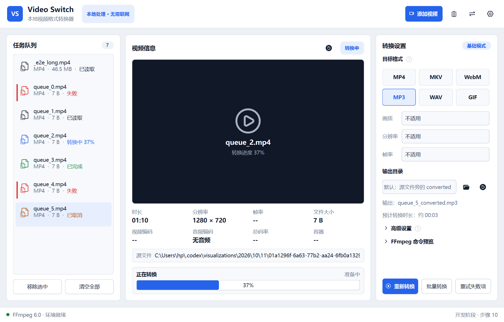
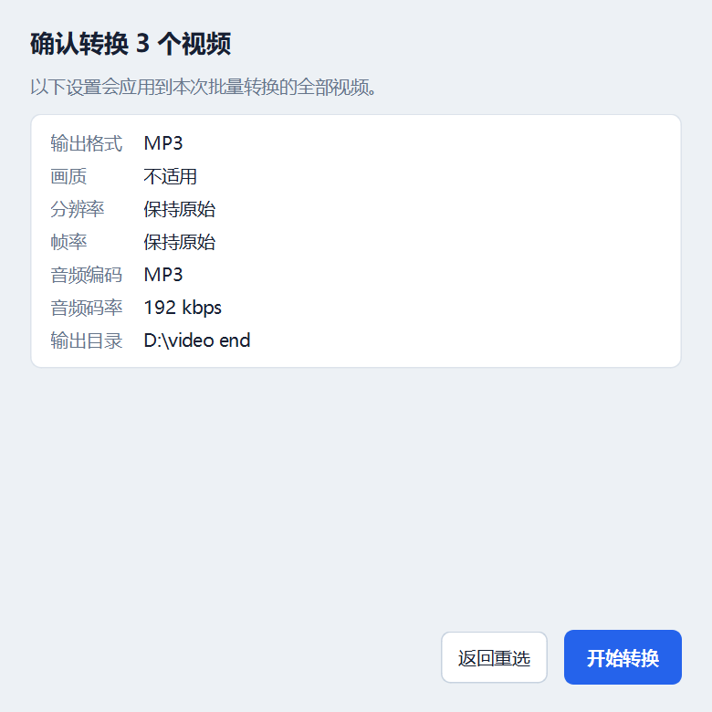

# Video Switch · 视频格式转换器

基于 PySide6 与本地 FFmpeg 命令行的 Windows 桌面视频转换工具。全程本地处理，
不上传素材、不依赖云端服务，运行时不调用任何远程 API。





## 项目介绍

在线转换站点普遍存在排队、体积限制和素材上传的隐私顾虑，而直接使用命令行又需要记住
一长串参数。Video Switch 把这两件事一起收敛掉：把视频拖进窗口、选好输出格式，
信息读取、缩略图、参数拼装、进度跟踪、失败重试都由程序完成。

应用的核心是一层薄而稳的 FFmpeg 封装：媒体信息由 ffprobe 读取，缩略图与转码由 ffmpeg
执行，界面只负责参数、进度与结果呈现。既保留了命令行的全部能力，又不需要用户接触命令。

主要能力：

- 导入视频后自动读取时长、分辨率、帧率、编码、码率与容器信息，并生成缩略图。
- 提供 MP4、MKV、WebM、MP3、WAV、GIF 六种输出预设与完整高级参数，实时预览 FFmpeg 命令。
- 支持单文件转换与批量队列：实时进度、速度、剩余时间，可随时取消。
- 取消后可继续转换：MP4/MKV/WebM/MP3/WAV 按时长自动切分为 30 秒分段，
  取消只丢弃未完成的分段，应用重启后依然可以接着转。
- 转换历史按源视频分组，记录格式、输出目录、状态、耗时与文件大小。
- 失败原因翻译成中文提示（磁盘空间不足、目录无权限、文件损坏、编码器不支持等），
  原始 FFmpeg 输出保留在可展开的日志中。

## 技术栈

| 分类 | 选型 |
| --- | --- |
| 语言与运行时 | Python 3.12+ |
| 桌面界面 | PySide6-Essentials（Qt Widgets）、QSS 主题、`QStyledItemDelegate` 自绘队列行 |
| 进程与并发 | `QProcess` 异步调用 ffmpeg/ffprobe，队列串行执行，界面线程零阻塞 |
| 媒体处理 | FFmpeg 6.0 / ffprobe 命令行（不接入 FFmpeg API） |
| 数据持久化 | `QSettings`（窗口几何、任务路径、分段续转记录）、AppData JSON（转换历史） |
| 测试 | pytest、pytest-qt、pytest-cov（184 个用例，覆盖率 88%） |
| 代码质量 | Ruff（lint + format） |
| 打包 | PyInstaller（内置 FFmpeg，免安装运行） |
| 依赖管理 | uv |

## 功能列表

**导入**

- 文件选择与拖拽批量导入，支持 MP4、MKV、MOV、AVI、WebM、FLV、M4V、WMV、MPG、TS、3GP。
- 基于内容指纹去重：同一视频改名或重复拖入都不会产生重复任务。
- 不支持的文件给出明确提示与原因列表；任务路径持久化，重启后自动恢复。

**信息与预览**

- ffprobe 读取时长、分辨率、帧率、视频/音频编码、码率与容器。
- 缩略图异步生成并缓存；缓存目录上限 200 个文件 / 128 MB，超出后清理最旧条目。
- 长文件名与长路径中部省略，鼠标悬停匀速滚动显示完整内容。

**转换参数**

- 六种输出预设（MP4 / MKV / WebM / MP3 / WAV / GIF），切换格式自动套用对应编码器与默认参数。
- 高级参数：视频编码、CRF、音频编码、音频码率、分辨率、帧率、是否保留音频。
- 输出格式与高级参数说明卡片，解释每种格式的适用场景和每个参数的含义。
- 实时 FFmpeg 命令预览与预计转换时长；纯音频格式自动禁用无关参数并显示“不适用”。

**单文件转换**

- 实时百分比、编码速度与剩余时间，FFmpeg 原始日志可展开查看。
- 取消在 300 ms 内生效（实测 266 ms）；取消后已完成分段保留，可继续转换。
- 完成结果提供“打开文件”“打开所在目录”，并可清除状态以便重新转换。

**批量队列**

- “批量转换”先弹出勾选窗口选择参与的视频，再弹出参数确认窗口列出全部生效设置。
- 串行执行，单个失败不影响其余任务；无法读取的文件自动跳过并计入汇总。
- 底部状态栏显示整体进度（`批量 2/3 · 当前 45%` + 进度条）。
- 随时可“取消全部”；失败任务提供“重试失败项”一键重跑。

**历史记录**

- 按源视频分组，只显示当前选中视频的记录，包含格式、输出目录、状态、耗时与文件大小。
- 支持删除单条历史、清空该视频历史；删除任务时可选同步删除关联历史。

**异常与恢复**

- FFmpeg 失败原因翻译为中文可执行提示，原始输出完整保留在日志中。
- 转换前检查源文件是否存在，被移动或删除时直接提示重新导入。
- 应用关闭导致转换中断后，下次启动识别保留的分段并提示可继续转换。
- 未预期异常写入 `%APPDATA%\VideoSwitch\Video Switch\logs\video-switch.log` 并提示日志位置。

**界面**

- 三栏工作区（任务队列 / 视频信息 / 转换设置），浅色与深色双主题。
- 队列条目按状态着色（转换中蓝、已完成绿、失败红、已取消橙、待读取灰），失败行带侧色条。
- 窗口大小、位置与最大化状态记忆；全部文字与背景对比度 ≥ 4.5:1。
- 快捷键：`Ctrl+O` 添加、`Ctrl+Enter` 转换、`Ctrl+Shift+B` 批量、`Esc` 取消、`Delete` 移除。

## 环境准备

### 方式一：直接使用（无需任何环境）

从 Releases 下载 `VideoSwitch-<版本>-win64.zip`，解压到任意目录后双击 `VideoSwitch.exe`。
压缩包已内置 ffmpeg 与 ffprobe，不需要安装 Python 或 FFmpeg。

### 方式二：从源码运行

1. Windows 10 / 11。
2. 安装 [uv](https://docs.astral.sh/uv/)：

   ```powershell
   winget install --id=astral-sh.uv -e
   ```

3. 准备 FFmpeg（需要 ffmpeg 与 ffprobe 两个可执行文件）。程序按以下顺序查找：
   - 设置窗口中手动指定的路径；
   - 程序目录下的 `ffmpeg/bin/`、`tools/ffmpeg/bin/`、`.tools/ffmpeg/bin/`；
   - 系统 `PATH`。

   仓库不包含 FFmpeg 二进制（`.tools/` 已在 `.gitignore` 中排除）。开发时把解压出来的
   `ffmpeg/bin` 放到仓库根目录的 `.tools/ffmpeg/bin`，程序会自动识别。

## 运行步骤

```powershell
# 1. 获取源码
git clone https://github.com/<你的用户名>/video-switch.git
cd video-switch

# 2. 安装依赖（自动创建虚拟环境）
uv sync

# 3. 启动应用
uv run video-switch
```

也可以使用模块入口：

```powershell
uv run python -m video_switch
```

开发与检查命令：

```powershell
# 全部测试（含真实 FFmpeg 端到端用例，约 15 秒）
uv run pytest

# 只跑单元测试（无 FFmpeg 的环境同样可跑）
uv run pytest -m "not slow"

# 覆盖率报告
uv run pytest --cov=video_switch --cov-report=term-missing

# 代码检查与格式检查
uv run ruff check .
uv run ruff format --check .
```

端到端测试在没有 FFmpeg 的机器上会自动跳过，不会造成失败。

## 代码调用示例

界面之外，核心服务可以独立调用。

生成一条 FFmpeg 命令（界面里的“命令预览”用的就是它）：

```python
from pathlib import Path

from video_switch.models.conversion_settings import ConversionSettings
from video_switch.services.ffmpeg_command import build_command_preview

settings = ConversionSettings(output_format="MP4", resolution="720p", frame_rate="30 FPS")
print(build_command_preview(settings, Path("input.mov"), Path("out/input.mp4"), Path("ffmpeg")))
# ffmpeg -hide_banner -loglevel warning -y -i input.mov -c:v libx264 -preset medium \
#   -crf 23 -vf scale=-2:720 -r 30 -c:a aac -b:a 192k -movflags +faststart out/input.mp4
```

解析 ffprobe 输出：

```python
from pathlib import Path

from video_switch.services.media_probe import parse_ffprobe_output

info = parse_ffprobe_output(ffprobe_json_text, Path("input.mp4"))
print(info.duration_text, info.resolution_text, info.video_codec_text)
# 00:04 1280 × 720 H264
```

驱动一次转换（同一个运行器支撑单文件与批量队列）：

```python
from datetime import datetime
from pathlib import Path

from PySide6.QtCore import QCoreApplication

from video_switch.models.conversion_settings import ConversionSettings
from video_switch.models.media_info import MediaInfo
from video_switch.models.media_task import MediaTask, TaskStatus
from video_switch.services.conversion_runner import ConversionRunner

source = Path("input.mp4")
task = MediaTask(
    path=source,
    size_bytes=source.stat().st_size,
    content_signature="demo",
    imported_at=datetime.now(),
    status=TaskStatus.METADATA_READY,
    media_info=MediaInfo(duration_seconds=4.0, width=1280, height=720),
)

app = QCoreApplication([])
runner = ConversionRunner()
runner.progress.connect(lambda item: print(f"{item.percent:.1f}%"))
runner.finished.connect(
    lambda result: (print(result.success, result.output_path), app.quit())
)
runner.start(task, ConversionSettings(), Path("out"), Path("ffmpeg"))
app.exec()
```

启动完整应用：

```python
from video_switch import main

main()
```

## 项目目录结构

```text
video-switch/
├── src/video_switch/
│   ├── app.py                      # 应用入口：高 DPI、字体、全局异常钩子
│   ├── formatting.py               # 时长与速度的统一格式化
│   ├── models/                     # 媒体任务、媒体信息、转换设置、历史记录
│   ├── services/                   # 与界面无关的核心能力
│   │   ├── ffmpeg_command.py       # 参数拼装与命令预览
│   │   ├── conversion_runner.py    # 分段转换、进度解析、取消与续转
│   │   ├── media_probe.py          # ffprobe 异步读取与结果解析
│   │   ├── thumbnail.py            # 缩略图生成、缓存与淘汰
│   │   ├── history_store.py        # 转换历史持久化
│   │   ├── toolchain.py            # FFmpeg/ffprobe 查找与版本校验
│   │   ├── video_importer.py       # 导入校验、去重与内容指纹
│   │   ├── error_messages.py       # FFmpeg 报错到中文提示的分类规则
│   │   ├── crash_handler.py        # 未预期异常日志
│   │   └── qt_process.py           # QProcess 公共处理
│   ├── ui/                         # 主窗口、主题、弹窗、自绘队列委托
│   └── resources/icons/            # 界面 SVG 图标
├── tests/
│   ├── e2e/                        # 需要真实 FFmpeg 的端到端测试（缺失时自动跳过）
│   └── test_*.py                   # 单元与界面测试
├── docs/                           # 会话总结、决策记录、FFmpeg 说明、性能与测试报告
├── icon/                           # 原始矢量图标素材
├── pyproject.toml                  # 项目配置、依赖与工具设置
└── uv.lock                         # 可复现依赖锁
```

## 后续优化方向

**发布与工程化**

- PyInstaller 打包（内置 FFmpeg）并上传 GitHub Release，提供免安装压缩包。
- GitHub Actions 在 Windows runner 上执行 Ruff 检查与测试，保证持续可验证。

**转换能力**

- 接入硬件加速编码（NVENC / QSV / AMF），在支持的机器上显著缩短长视频耗时。
- 扩展字幕、多音轨等高级选项与更多容器组合。
- 为每个任务单独保存参数，而不是整批共用一套设置。

**使用体验**

- 队列多选与拖动排序，批量场景下更接近文件管理器的操作习惯。
- 任务与历史导出为 CSV / JSON，便于归档与二次处理。
- 自定义输出命名模板（前缀、后缀、变量替换）。
- 跟随系统主题自动切换深浅色。

**性能与稳定性**

- 端到端用例扩展到 4K 与长视频，覆盖更大素材下的内存与磁盘占用。
- 分段时长按素材规模自适应，进一步减少长时间任务的合并开销。

## 相关文档

- [会话总结](docs/会话总结.md)
- [开发决策记录](docs/开发决策记录.md)
- [性能与测试报告](docs/性能与测试报告.md)
- [FFmpeg 入门说明](docs/FFmpeg说明.md)

## 项目亮点

1. **完整的桌面客户端形态**（面试官明确关注客户端相关度）：三栏工作区、异步 ffprobe 与
   缩略图、`QStyledItemDelegate` 自绘队列行、DPI 感知的 SVG 渲染、深浅双主题、
   窗口几何记忆、键盘快捷键；界面全部文字与背景对比度 ≥ 4.5:1。

2. **命令行转码的正确用法与断点续转**：FFmpeg 命令行本身没有断点续传，项目把
   MP4/MKV/WebM/MP3/WAV 按时长切成 30 秒分段，取消只丢弃未完成的分段，完成后用
   concat 无损合并；分段信息按源文件内容指纹持久化，应用重启后依然可以继续转换。

3. **实测驱动的性能优化**：取消响应从 1516 ms 降到 266 ms（定位到 Windows 上
   `QProcess.terminate()` 对控制台进程无效，真正的停止只能等兜底强杀）；
   实测导入 20 个文件 32 ms、47 MB 文件指纹不到 1 ms、分段开销落在测量噪声内，
   据此决定“不优化”，同时修掉了每段遗留 `QProcess` 对象与缩略图缓存无上限两个真问题。

4. **一次真实的崩溃排查**：FFmpeg 首个进度块会把时间戳写成 `AV_NOPTS_VALUE`
   （`-9223372036854775807`），被当作有效值后算出 `-2.3e14%` 的进度，导致
   `QProgressBar` 溢出异常并打断界面处理链（表现为历史记录串到别的视频、批量转换卡死）。
   修复方式是在解析层过滤负数时间戳，并在界面层再加一道钳制。

5. **可运行的工程化证据**：184 个测试（含 7 个真实 FFmpeg 端到端用例），总体覆盖率 88%、
   服务层 91%；检测不到 FFmpeg 时端到端用例自动跳过，Ruff 检查与格式检查全绿。

6. **面向普通用户的产品化细节**：失败原因翻译成中文并给出下一步建议、失败任务一键重试、
   首次运行缺少 FFmpeg 时的一次性引导、参数与格式说明卡片、转换历史按源视频分组、
   长路径悬停滚动。

7. **过程可追溯**：会话总结、决策记录（DR-001 ~ DR-094）与性能测试报告完整记录了
   需求、取舍与验证数据，可直接作为 AI 协作过程的证据。
